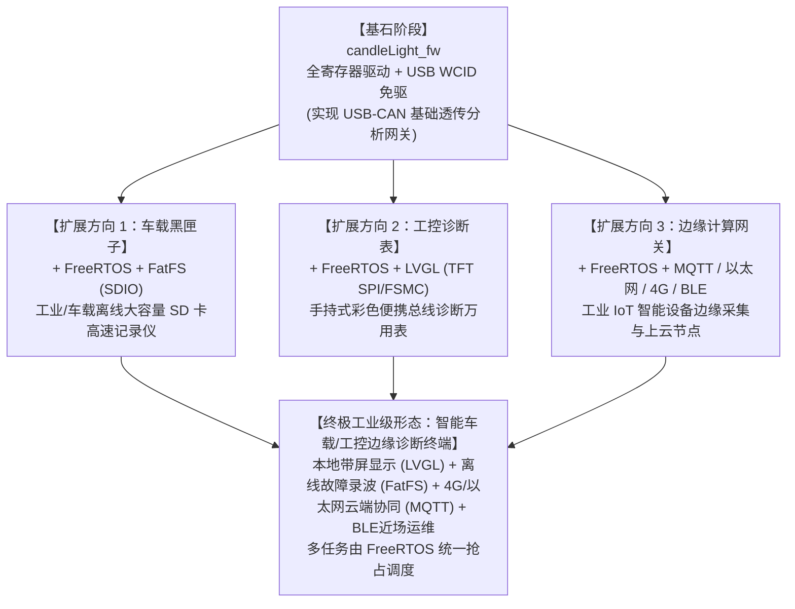

# 嵌入式与硬件全栈进阶学习路线看板（量化指标与多维层级版）

> **说明与使用指南**：
> 1. 本路线专为 **“以路线 B（MCU 固件开发）为主，路线 A（硬件/PCB 知识）为辅”** 的国内求职者打造；
> 2. 贯彻 **“以技术视频/开源项目快速上手跑通，以官方芯片/内核文档深挖底层机理”** 的工程闭环方法论；
> 3. **层级标定体系（四层套三层）**：学习路线按学习里程碑（Phase）推进，但每个任务均严格标明其在以下立体结构中的层级归属：
>    * **【指标及通过标准】**：物理量化参数、波形精度、稳定性门槛与验收规则
>    * **【Hardware (硬件层)】**：细分为 **ARM 内核层**、**MCU 芯片系统层**、**Board 板级电路层**
>    * **【Firmware (固件层)】**：驱动、状态机、通信协议栈、算法闭环
>    * **【RTOS & Linux (系统与富应用层)】**：多任务调度、IPC通信、内存管理、上位机/操作系统协同

---

## 目录（Table of Contents）
- [架构图解：四层套三层立体映射体系](#架构图解四层套三层立体映射体系)
- [阶段零：基石筑基与最小系统闭环（软硬件从0到1）](#阶段零基石筑基与最小系统闭环软硬件从0到1)
  - [任务 0.1：MCU 最小系统原理图与元器件选型](#任务-01mcu-最小系统原理图与元器件选型)
  - [任务 0.2：双层/四层 PCB 布局走线与 DFM 可制造性设计](#任务-02双层四层-pcb-布局走线与-dfm-可制造性设计)
  - [任务 0.3：ARM Cortex-M 存储器映射与启动流程](#任务-03arm-cortex-m-存储器映射与启动流程reset-sequence)
  - [任务 0.4：时钟树（RCC）满频配置与微秒/毫秒非阻塞延时](#任务-04时钟树rcc满频配置与微秒毫秒非阻塞延时)
- [阶段一：工业总线与模拟采集（工控通信硬通货）](#阶段一工业总线与模拟采集工控通信硬通货)
  - [任务 1.1：CAN 物理层收发器电路与总线差分阻抗控制](#任务-11can-物理层收发器电路与总线差分阻抗控制)
  - [任务 1.2：CAN 位时序计算、寄存器配置与硬件过滤器](#任务-12can-位时序计算寄存器配置与硬件过滤器)
  - [任务 1.3：环形缓冲区（Ring Buffer）架构与 1Mbps 压力压测](#任务-13环形缓冲区ring-buffer架构与-1mbps-压力压测)
  - [任务 1.4：ADC 模拟前端（AFE）调理与 DMA 循环采样](#任务-14adc-模拟前端afe调理与-dma-循环采样)
- [阶段二：闭环控制算法与传感器驱动（运动与感知）](#阶段二闭环控制算法与传感器驱动运动与感知)
  - [任务 2.1：I2C/SPI 总线时序与六轴 IMU 驱动](#任务-21i2cspi-总线时序与六轴-imu-驱动)
  - [任务 2.2：互补滤波（Complementary Filter）姿态解算](#任务-22互补滤波complementary-filter姿态解算)
  - [任务 2.3：增量式与位置式 PID 算法工程化实现](#任务-23增量式与位置式-pid-算法工程化实现)
- [阶段三：RTOS 架构跃迁与多任务调度（从裸机到系统）](#阶段三rtos-架构跃迁与多任务调度从裸机到系统)
  - [任务 3.1：ARM Cortex-M 双堆栈指针与上下文切换](#任务-31arm-cortex-m-双堆栈指针msppsp与上下文切换context-switch)
  - [任务 3.2：任务优先级划分、堆栈水印与内存管理](#任务-32任务优先级划分堆栈水印与内存管理)
  - [任务 3.3：IPC 通信机制（Queue、Mutex 与 EventGroup）](#任务-33ipc-通信机制队列-queue互斥锁-mutex-与事件组-eventgroup)
- [阶段四：桌面级新颖明星项目落地（替代传统平衡车，四选一深入）](#阶段四桌面级新颖明星项目落地替代传统平衡车四选一深入)
  - [项目选项 A：SmartKnob 桌面智能力反馈旋钮](#项目选项-asmartknob-桌面智能力反馈旋钮偏消费电子人机交互与无刷控制)
  - [项目选项 B：工业级高速 USB-CAN 协议分析网关](#项目选项-b工业级高速-usb-can-协议分析网关偏工控自动化汽车电子与通信协议)
  - [项目选项 C：便携式智能恒温烙铁控制系统](#项目选项-c便携式智能恒温烙铁控制系统参考-ironos偏电源控制模拟调理与低功耗)
  - [项目选项 D：桌面动量轮自平衡立方体（脱离 Arduino 架构指南）](#项目选项-d桌面动量轮自平衡立方体偏算法闭环机器人底盘彻底替代两轮平衡车)
  - [项目选项 E：LVGL 嵌入式 GUI 综合仪表盘（偏 HMI 工业界面与图形渲染调度）](#项目选项-e-lvgl-嵌入式-gui-综合仪表盘偏-hmi-工业界面图形渲染与-freertos-协同调度)
  - [项目选项 F：SD 卡数据记录仪（FatFS 文件系统 + SPI/SDIO，偏仪器仪表与工业数据存储）](#项目选项-fsd-卡数据记录仪fatfs-文件系统--spi/sdio偏仪器仪表与工业数据存储)
  - [项目选项 G：STM32 以太网工业网关（LwIP + FreeRTOS，偏工业 IoT 与边缘计算）](#项目选项-gstm32-以太网工业网关lwip--freertos偏工业-iot-与边缘计算)
- [阶段五：国内招聘面试通关与“STAR”工程封装](#阶段五国内招聘面试通关与star工程封装)
  - [任务 5.1：软硬件综合排障案例提炼](#任务-51软硬件综合排障案例提炼面试高频追问)
  - [任务 5.2：官方芯片文档高频必考题通关自查](#任务-52官方芯片文档高频必考题通关自查)

---

## 架构图解：四层套三层立体映射体系

```
┌────────────────────────────────────────────────────────────────────────┐
│  1. 指标及通过标准 (Metrics & Pass Criteria)：物理量化、波形、丢包率、验收门槛    │
├────────────────────────────────────────────────────────────────────────┤
│  2. Hardware (硬件层)                                                  │
│     ├── [ARM 内核层]：NVIC、SysTick、MPU、Fault异常、寄存器模型与流水线   │
│     ├── [MCU 芯片层]：RCC时钟树、总线矩阵、片上外设(DMA/TIM/ADC)、电气极限 │
│     └── [Board 板级层]：原理图、LDO/DCDC、退耦、走线阻抗、TVS防护、EMC/DFM  │
├────────────────────────────────────────────────────────────────────────┤
│  3. Firmware (固件层)：HAL/LL、寄存器驱动、状态机、RingBuffer、中断、PID闭环│
├────────────────────────────────────────────────────────────────────────┤
│  4. RTOS & Linux (系统与富应用层)：FreeRTOS多任务调度、队列、IPC、上位机通信 │
└────────────────────────────────────────────────────────────────────────┘
```

---

## 阶段零：基石筑基与最小系统闭环（软硬件从0到1）

### 阶段目标
在个人书桌上，仅靠电脑和基础仪器，完成一块自绘 STM32 最小系统核心板的设计、焊接、调试、时钟树拉满与基础时序验证。

- [ ] **任务 0.1：MCU 最小系统原理图与元器件选型**
  * **所属层级**：`[Hardware: Board-PCB]` & `[Hardware: MCU-System]`
  * **学习内容**：外部晶振电路；供电拓扑设计（5V 转 3.3V LDO）、复位电路（RC 充放电时常）与BOOT 引脚配置、SWD 调试接口。
  * **官方文档精读**：
    * ST 官方 [*AN2586: Getting started with STM32F10xxx hardware development*](https://www.st.com/resource/en/application_note/an2586-getting-started-with-stm32f10xxx-hardware-development-stmicroelectronics.pdf)（全文通读，掌握电源退耦和复位要求）
    * ST 官方 [*AN2867: Oscillator design guide for STM8/STM32*](https://www.st.com/resource/en/application_note/an2867-oscillator-design-guide-for-stm8afals-stm32-mcus-and-mpus-stmicroelectronics.pdf)（第 3、4 章：晶振跨导 $g_m$ 裕量计算与负载电容 $C_L$ 匹配公式）
  * **工程经验**
    * PCB 表面的铜箔走线，寄生电感约为 **$1\text{ nH/mm}$**。
    * ST 官方规范（AN2586）：100nF 陶瓷电容作为高频去耦电容，4.7μF～10μF 陶瓷电容作为 低频bulk 电容。
    * 大小电容成对出现（10μF + 0.1μF 或 1μF + 0.1μF）是几乎所有工业级稳压芯片的标准“黄金搭档”设计准则。
  * **指标及通过标准 (Pass Criteria)**：
    1. 计算外部 8MHz 晶振匹配电容：公式 $C_L = \frac{C_{L1} \cdot C_{L2}}{C_{L1} + C_{L2}} + C_s$，取 PCB 寄生电容 $C_s \approx 3\sim5\text{pF}$，准确得出 $C_{L1}=C_{L2}=20\text{pF}$；
    2. 原理图所有 $V_{DD}$ 与 $V_{DDA}$ 引脚均就近配置 100nF 陶瓷去耦电容，且总供电入口放置 $4.7\mu\text{F}\sim10\mu\text{F}$ 储能钽电容/瓷片电容；
    3. 复位脚（NRST）RC 低通滤波时间常数满足 $\tau = R \times C \ge 1\text{ms}$（常用 $10\text{k}\Omega + 100\text{nF}$）。
  
- [ ] **任务 0.2：双层/四层 PCB 布局走线与 DFM 可制造性设计**
  * **所属层级**：`[Hardware: Board-PCB]`
  * **学习内容**：立创 EDA / AD 绘制 PCB。地平面完整性、晶振包地与禁布区、退耦电容“先经电容后进管脚”走线规则。
  * **官方文档精读**：ST 官方 [*AN5036: Thermal management guidelines for STM32 32-bit Arm Cortex MCUs*](https://www.st.com/resource/en/application_note/an5036-thermal-management-guidelines-for-stm32-32bit-arm-cortex-mcus-stmicroelectronics.pdf)（散热与铜皮铺地规范）
  * **指标及通过标准 (Pass Criteria)**：
    1. 晶振引脚紧靠 MCU，下方地平面完整无走线割裂，走线包地并打过孔屏蔽，总长度 $< 12\text{mm}$；
    2. 板卡打样回板后，万用表二极管档测 3.3V 与 GND 无短路；上电后，用示波器交流耦合档测量 3.3V 纹波峰峰值 $V_{pp} < 30\text{mV}$。

- [ ] **任务 0.3：ARM Cortex-M 存储器映射与启动流程（Reset Sequence）**
  * **所属层级**：`[Hardware: ARM-Core]` & `[Hardware: MCU-System]`
  * **学习内容**：MSP 初始堆栈指针加载、PC 指针重载、复位向量表（Vector Table）、启动文件（`startup_stm32xxx.s`）逐行解析。
  * **官方文档精读**：
    * 《The Definitive Guide to ARM Cortex-M3 and Cortex-M4》（Joseph Yiu 著）第 5 章：*Memory System* 与第 14 章：*Getting Started with Keil/GCC*
    * ST 官方 [*RM0008 Reference Manual*](https://www.st.com/resource/en/reference_manual/rm0008-stm32f101xx-stm32f102xx-stm32f103xx-stm32f105xx-and-stm32f107xx-advanced-armbased-32bit-mcus-stmicroelectronics.pdf) 的 *Flash memory and memory organization* 章节
  * **指标及通过标准 (Pass Criteria)**：
    1. 能画出从上电复位到进入 `main()` 函数的完整硬件流程图（从地址 `0x0000_0000` 取 MSP $\rightarrow$ 从 `0x0000_0004` 取 Reset_Handler 地址 $\rightarrow$ 运行 SystemInit $\rightarrow$ 跳转 `__main`）；
    2. 能在调试器（Debugger）汇编断点下，指出当前 SP 寄存器数值是否与向量表第 0 项严格一致。

- [ ] **任务 0.4：时钟树（RCC）满频配置与微秒/毫秒非阻塞延时**
  * **所属层级**：`[Hardware: MCU-System]` & `[Firmware]`
  * **学习内容**：配置 HSE/PLL 倍频至最高主频（如 F103 为 72MHz，G431 为 170MHz）；基于 ARM SysTick 滴答定时器编写精准微秒/毫秒延时。
  * **官方文档精读**：
    * Joseph Yiu《ARM Cortex 权威指南》第 9 章：*System Timer (SysTick)*
    * 芯片手册 [*RM0008 Reference Manual*](https://www.st.com/resource/en/reference_manual/rm0008-stm32f101xx-stm32f102xx-stm32f103xx-stm32f105xx-and-stm32f107xx-advanced-armbased-32bit-mcus-stmicroelectronics.pdf) 的 *RCC (Reset and Clock Controller)* 章节
  * **指标及通过标准 (Pass Criteria)**：
    1. 通过 MCO（Microcontroller Clock Output）引脚输出内部 SYSCLK 时钟，用示波器测量其实际频率，误差 $\le 0.5\%$；
    2. 编写 `delay_us()` 与 `delay_ms()`，用逻辑分析仪捕获 GPIO 引脚翻转波形，实测 $10\mu\text{s}$ 与 $10\text{ms}$ 延时误差均在 $1\%$ 以内。

---

## 阶段一：工业总线与模拟采集（工控通信硬通货）

### 阶段目标

在桌面上完成两块板卡之间的 1Mbps CAN 总线抗饱和通信，掌握高精度多通道 ADC+DMA 数据采集与模拟前端调理。

- [ ] **任务 1.1：CAN 物理层收发器电路与总线差分阻抗控制**
  * **所属层级**：`[Hardware: Board-PCB]`
  * **学习内容**：CAN 收发器（SIT1050/TJA1050）电路设计、120Ω 终端电阻配置、PESD1CAN / TVS 静电防护阵列。
  * **官方文档精读**：TI 官方应用笔记 [*SLLA270: Controller Area Network Physical Layer Requirements*](https://www.ti.com/lit/an/slla270/slla270.pdf)（差分电平规范与线缆寄生效应）
  * **指标及通过标准 (Pass Criteria)**：
    1. 掌握隐性（Recessive）与显性（Dominant）电平：示波器实测显性时 $V_{CANH} \approx 3.5\text{V}$, $V_{CANL} \approx 1.5\text{V}$, 差分压差 $\Delta V \approx 2.0\text{V}$；隐性时差分压差 $\Delta V \approx 0\text{V}$；
    2. CAN 走线严格控制为 $120\Omega$ 差分阻抗，总线首尾两端各接入一只 $120\Omega$ 终端匹配电阻（或两只 $60\Omega$ 串联加共模滤波电容）。

- [ ] **任务 1.2：CAN 位时序计算、寄存器配置与硬件过滤器**
  * **所属层级**：`[Hardware: MCU-System]` & `[Firmware]`
  * **学习内容**：CAN 标称位时间划分（Sync_Seg, BS1, BS2）、波特率分频器 Prescaler 计算、CAN 硬件掩码过滤器（Mask Mode & Identifier List Mode）。
  * **官方文档精读**：芯片手册 *Reference Manual (RM)* 的 *Controller area network (bxCAN/FDCAN)* 章节中 “Bit timing” 与 “Filter match index”
  * **指标及通过标准 (Pass Criteria)**：
    1. 准确推导并配置波特率寄存器，使 500kbps 与 1Mbps 采样点均精确落在 $87.5\%$ 推荐位置； 
    2. 配置硬件过滤器为掩码模式（Mask），仅允许接收扩展帧 ID `0x18F001XX` 的报文；其余无关 ID 报文在硬件层面自动过滤丢弃，**CPU 接收中断触发率为 0**。

- [ ] **任务 1.3：环形缓冲区（Ring Buffer）架构与 1Mbps 压力压测**
  * **所属层级**：`[Firmware]`
  * **学习内容**：设计基于单生产者-单消费者（SPSC）的无锁/原子操作环形队列，解决高波特率中断与主循环处理速度不匹配造成的溢出。
  * **推荐调试工具**：[*cangaroo 开源 CAN 分析上位机*](https://github.com/hubert-b/cangaroo)
  * **指标及通过标准 (Pass Criteria)**：
    1. 电脑上位机（如 USB-CAN 分析仪）以 1Mbps 波特率、每隔 1ms 发送 1 帧数据，持续发送 100,000 帧（10 万帧）；
    2. 单片机接收并原样回传，上位机统计端：**丢帧率（Frame Drop Rate）= 0，且单片机无溢出错误（FOVR）与总线挂死（Bus-Off）**。

- [ ] **任务 1.4：ADC 模拟前端（AFE）调理与 DMA 循环采样**
  * **所属层级**：`[Hardware: Board-PCB]` & `[Hardware: MCU-System]` & `[Firmware]`
  * **学习内容**：运放（OPA333/LMV358）微弱信号跟随与滤波、RC 低通滤波截止频率设计、ADC 规则通道与 DMA 循环传输。
  * **官方文档精读**：ST 官方 [*AN2834: How to get the best ADC accuracy in STM32 microcontrollers*](https://www.st.com/resource/en/application_note/an2834-how-to-get-the-best-adc-accuracy-in-stm32-microcontrollers-stmicroelectronics.pdf)（重点阅读第 2 章：电源噪声对 ADC 参考电压的影响、采样时间与输入阻抗匹配）
  * **指标及通过标准 (Pass Criteria)**：
    1. RC 低通滤波器截止频率 $f_c = \frac{1}{2\pi RC}$ 设置为被测信号最高频率的 3~5 倍；
    2. 开启 DMA 循环模式持续采集 1000 个样点，在 Firmware 内部进行滑动均值滤波算法处理后，静止输入下数值波动范围在 $\le \pm 2\text{ LSB}$（以 12 位 ADC 为例）。

---

## 阶段二：闭环控制算法与传感器驱动（运动与感知）

### 阶段目标
在桌面上驱动六轴姿态传感器与执行器（电机/加热片），编写抗饱和 PID 闭环控制算法，并通过电脑上位机实时输出平滑动态曲线。

- [ ] **任务 2.1：I2C/SPI 总线时序与六轴 IMU 驱动**
  * **所属层级**：`[Hardware: Board-PCB]` & `[Firmware]`
  * **学习内容**：I2C 开漏上拉电阻计算（1.5k~4.7kΩ 取决于总线电容）、SPI 极性相位配置；传感器寄存器配置与原始角速度/加速度读取。
  * **官方文档精读**：InvenSense 官方 *MPU-6000/MPU-6050 Register Map and Descriptions*（重点阅读 PWR_MGMT_1, ACCEL_CONFIG, GYRO_CONFIG 寄存器）
  * **指标及通过标准 (Pass Criteria)**：
    1. 用逻辑分析仪抓取 I2C 波形，时序无 NACK 错帧，上升沿时间 $t_r < 300\text{ns}$；
    2. 读取传感器设备 ID（WhoAmI）成功，静止状态下读取三轴原始加速度，Z 轴加速度数据稳定在 $\approx 1g$（约 16384 LSB @ $\pm 2g$ 档位）。

- [ ] **任务 2.2：互补滤波（Complementary Filter）姿态解算**
  * **所属层级**：`[Firmware]`
  * **学习内容**：利用加速度计的低频静态重力矢量校准陀螺仪的高频角速度积分漂移，解算出平滑的 Pitch 与 Roll 角度。
  * **指标及通过标准 (Pass Criteria)**：
    1. 姿态解算程序以定时器中断为基准，严格以 $5\text{ms}$（200Hz）固定周期触发；
    2. 静态放置在桌面上，连续监测 10 分钟，Pitch/Roll 输出角度零漂 $< 0.5^\circ$；用手快速颠簸晃动传感器，输出角度平滑过渡，无发散抖动。

- [ ] **任务 2.3：增量式与位置式 PID 算法工程化实现**
  * **所属层级**：`[Firmware]` & `[指标及通过标准]`
  * **学习内容**：编写通用 PID 结构体与计算函数，加入**积分分离**、**抗积分饱和（Anti-Windup）**与**微分先行**。
  * **推荐调试工具**：[*VOFA+ 数字波形调试上位机*](https://www.vofa.plus/)
  * **指标及通过标准 (Pass Criteria)**：
    1. 搭建上位机（VOFA+ 或自写 Qt 串口助手），通过自定义协议每 10ms 上报一次 Target, Actual, Output 三条曲线；
    2. 阶跃响应测试：
       * 响应上升时间（Rise Time）符合工程设计值；
       * 稳态误差 $e_{ss} \le 1\%$；
       * 最大超调量（Overshoot）$\sigma\% \le 5\%$。

---

## 阶段三：RTOS 架构跃迁与多任务调度（从裸机到系统）

### 阶段目标

将单片机从传统的裸机 `while(1)` 轮询阻塞架构，重构为基于 FreeRTOS 的高可靠抢占式多任务系统。

- [ ] **任务 3.1：ARM Cortex-M 双堆栈指针（MSP/PSP）与上下文切换（Context Switch）**
  * **所属层级**：`[Hardware: ARM-Core]` & `[RTOS & Linux]`
  * **学习内容**：特权级与非特权级、MSP 与 PSP 切换原理；PendSV 延迟中断、SVC 系统调用、任务控制块（TCB）与现场保存。
  * **官方文档精读**：
    * Joseph Yiu《ARM Cortex 权威指南》第 10 章：*OS Support Features*（重点精读 PendSV 切换时序图）
    * [*FreeRTOS 官方内核架构文档*](https://www.freertos.org/Documentation/02-Kernel/00-Overview) 与移植源码 `port.c`（逐行研读 `xPortPendSVHandler` 汇编代码）
  * **指标及通过标准 (Pass Criteria)**：
    1. 能向面试官清晰解释：为什么任务上下文切换必须在最低中断优先级的 PendSV 中断里进行，而不能在 SysTick 中断里强行执行？
    2. 在 Keil / CubeIDE 调试器中，单步跟踪任务挂起时刻，在 Memory 窗口中正确指出保存到该任务堆栈中的 R0~R3, R12, LR, PC, xPSR 这 8 个由硬件自动压栈的寄存器位置。

- [ ] **任务 3.2：任务优先级划分、堆栈水印与内存管理**
  * **所属层级**：`[RTOS & Linux]`
  * **学习内容**：合理划分紧急度不同的控制任务、通信任务、UI任务；掌握 `heap_4.c` 内存碎片合并原理与任务堆栈大小计算。
  * **官方文档精读**：[*Mastering the FreeRTOS Real Time Kernel* (官方经典教材 PDF)](https://github.com/FreeRTOS/FreeRTOS-Kernel-Book) 第 2 章：Memory Management 与第 3 章：Task Management
  * **指标及通过标准 (Pass Criteria)**：
    1. 开启 `configCHECK_FOR_STACK_OVERFLOW = 2`；
    2. 故意在某任务中开辟超大局部数组引发溢出，系统能准确触发 `vApplicationStackOverflowHook()` 钩子函数报警；
    3. 调用 `uxTaskGetStackHighWaterMark()` 监测每个任务的历史最大栈深，将冗余栈空间收缩优化至 20%~30% 安全裕量内。

- [ ] **任务 3.3：IPC 通信机制（队列 Queue、互斥锁 Mutex 与事件组 EventGroup）**
  * **所属层级**：`[RTOS & Linux]` & `[Firmware]`
  * **学习内容**：中断安全版 API（`xxxFromISR`）、通过 Queue 传输传感器结构体、通过 Mutex 解决串口打印资源冲突与优先级继承（Priority Inheritance）。
  * **指标及通过标准 (Pass Criteria)**：
    1. 编写 3 个不同优先级的任务并发调用串口打印，无 Mutex 时串口字符串撕裂乱码；引入 Mutex 后，所有打印日志整齐完整，且验证高优先级任务不被中优先级任务长时间阻塞（无优先级反转死锁）；
    2. 传感器中断以 100Hz 速率通过 `xQueueSendFromISR` 发送数据，消费任务以阻塞等待方式取数据，系统 CPU 空闲率在 Idle 任务中维持在合理健康区间。

---

## 阶段四：桌面级新颖明星项目落地（替代传统平衡车，四选一深入）

### 阶段目标
在个人书桌上，仅靠 1~2 块定制硬件与一条 USB 线，将前面打磨的“最小系统、通信协议、闭环算法与 FreeRTOS”积木完整集成，打造出具有绝对差异化竞争力的简历核心项目。

> **架构逻辑**：以下 4 个新颖桌面项目均继承了阶段零至阶段三沉淀的基础模块。**请根据目标岗位方向，选择 1 个作为主攻（精力充沛可完成 2 个）**：

---

### 项目选项 A：SmartKnob 桌面智能力反馈旋钮（偏消费电子、人机交互与无刷控制）
* **开源代码仓库**：[`scottbez1/smartknob`](https://github.com/scottbez1/smartknob)（GitHub 5k+ Stars 原作）
* **继承积木**：【阶段零最小系统】+【阶段二 PID 算法】+【阶段三 FreeRTOS 调度】
* **任务清单**：
  - [ ] **【Hardware: Board-PCB】**：设计圆形双层/四层 PCB，集成 AS5600/MT6835 磁编码器、DRV8313/FD6288 无刷电机驱动桥、Type-C 供电与圆屏 LCD 接口；
  - [ ] **【Hardware: MCU-System】**：配置 TIM 高级控制定时器输出 3 路互补 PWM，配置死区时间（Dead-time Insertion，防上下管直通烧毁）；
  - [ ] **【Firmware】**：运行 SimpleFOC 磁场定向控制与力矩双闭环，编写虚拟卡位（Detent）、弹簧限位回弹、阻尼粘滞手感算法；
  - [ ] **【RTOS & Linux】**：FreeRTOS 调度：高频力矩控制任务（1kHz）、LCD 屏幕 UI 渲染任务（30Hz）与 USB 状态上报任务；
  - [ ] **【指标及通过标准 (Pass Criteria)】**：
    1. 单手握持旋钮旋转，手感具备清晰可调的物理机械棘轮感（12 档/24 档），且连续旋转 10 分钟电机及驱动芯片温升 $< 20^\circ\text{C}$；
    2. 枚举为标准 USB HID 复合设备，插上电脑无需额外驱动，旋转旋钮可平滑调节 PC 系统全局音量或视频剪辑时间轴缩放。

---

### 项目选项 B：工业级高速 USB-CAN 协议分析网关（偏工控自动化、汽车电子与通信协议）

> **行业定位与商业价值**：
> `candleLight_fw` 绝非简陋的转接固件，而是**整个工控与车载领域“USB 转 CAN”的底层工业基石**。
> 其原生兼容 Linux 内核主线 SocketCAN（`gs_usb` 驱动），在 Windows 下免驱枚举为 WinUSB / WCID 设备，直连 Wireshark、cangaroo、Python-CAN 等专业诊断工具。
> 掌握该固件不仅能吃透 USB 枚举与差分通信底层，更是迈向**汽车电子、工控网关、机器人动力总线与新能源 BMS** 核心开发岗位的标杆项目。

* **开源固件仓库**：[`candle-usb/candleLight_fw`](https://github.com/candle-usb/candleLight_fw)（支持 Linux `gs_usb`、Windows WCID 与各类上位机生态）
* **继承积木**：【阶段零最小系统】+【阶段一 1Mbps CAN 物理层与过滤器】+【阶段三 FreeRTOS 队列与多任务】

#### 1. 落地支撑体系（从 0 到 1 必备支撑）

```
┌────────────────────────────────────────────────────────────────────────┐
│                         支撑体系全景图                                   │
├─────────────────────┬──────────────────────┬───────────────────────────┤
│  1. 硬件电路载体     │  2. 编译与调试体系   │  3. 闭环测试与上位机生态   │
│  • STM32 最小系统    │  • arm-none-eabi-gcc │  • 双节点回环压测环境      │
│  • CAN 差分收发器    │  • CMake + Ninja     │  • Linux SocketCAN 生态   │
│  • Type-C 90Ω 差分   │  • SWD 硬件在线仿真  │  • Wireshark / cangaroo   │
│  • 120Ω 阻抗控制     │  • USB DFU 产线烧录  │  • Python-CAN 自动化脚本   │
└─────────────────────┴──────────────────────┴───────────────────────────┘
```

* **硬件电路设计规范**：
  * **核心 MCU 选型**：首选 **STM32F072C8T6**（QFP48/QFN32，低成本，自带晶振时钟自恢复 CRS 和专用 CAN/USB 内存）；进阶升级选 **STM32F407 / STM32G431**（支持大吞吐与后续富外设扩展）；
  * **物理层收发器**：非隔离方案选 **SIT1050T / TJA1050**；高可靠工业隔离方案选 **纳芯微 NSi1050 / 金升阳 TD501DCAN**；
  * **接口与保护**：Type-C CC1/CC2 各下拉 $5.1\text{k}\Omega$ 启用 5V；USB $D+$/$D-$ 严格走 $90\Omega$ 差分线；CANH/CANL 并联 **PESD1CAN** 或 TVS 静电防护管；总线两端引出跳线帽切换 $120\Omega$ 终端匹配电阻。
* **编译与调试体系**：配置 `arm-none-eabi-gcc` + `CMake` + `Ninja` 秒级编译；SWD 烧录首版固件后，通过板载 **USB DFU 模式** 实现免调试器在线固件升级。
* **闭环回环测试环境**：
  > **注意**：CAN 总线是差分广播总线，**单块板卡无法完成自发自收测试**（ACK 时钟槽必须有另一物理节点拉低应答，否则硬件报错挂死）。
  * 必须制作 **2 块板卡**（或 1 块自制板 + 1 个商用 USB-CAN 分析仪/电机/传感器），CANH/CANL 互联并接通 $120\Omega$ 电阻，在电脑端开双终端进行高波特率双向压测。

#### 2. 商业化产品形态与功能矩阵

市面上售价数百至上千元的汽车与工业电子工具，其内部核心架构与该项目完全同源：

| 商业化产品形态 | 行业对标产品 / 售价 | 核心商业功能与落地场景 |
| :--- | :--- | :--- |
| **形态一：汽车级总线分析仪与 OBD 诊断仪** | 对标 **PEAK PCAN-USB**（¥1500~¥3500）、致远 USBCAN（¥800~¥2000） | • **总线嗅探与逆向**：通过 OBD-II 监听动力/车身 CAN，实时捕获车速、油门开度、转角等。<br>• **UDS 协议诊断与固件刷写**：配合 ISO 14229 (UDS) 协议栈实现 ECU 故障码（DTC）清除与 Bootloader 刷写。<br>• **ECU 标定与在线调参**：支持 XCP / CCP 协议，对接 CANape、INCA 进行电控标定。 |
| **形态二：机器人与自动化伺服通信网关** | 宇树四足机器狗、协作机械臂、开源 3D 打印 Klipper 工具板 | • **伺服力矩控制主站**：工控机/树莓派挂载网关，以 1kHz 频率向 6~12 个无刷伺服电机下发力矩指令与回传编码器状态。<br>• **3D 打印工具板转接**：创想三维/大鱼/MKS 等销售的 USB-to-CAN 桥接板固件几乎 100% 源自 candleLight 衍生架构。 |
| **形态三：新能源储能 / BMS 产线测试工装** | 动力电池 PACK 产线、工商业储能柜自动化检测机柜 | • **BMS 自动化数据巡检**：以 7×24 小时满载百万帧不丢包性能，高频轮询读取单体电芯电压、温度、绝缘阻抗并同步入库。 |

#### 3. 架构扩展方向与技术衍生（与核心积木融合）

将芯片升级为 **STM32F407 / STM32G431 / STM32H7**，与 FreeRTOS、FatFS、LVGL、网络协议栈融合，可衍生出三款系统级工业整机：



* **扩展方向 A：+ FreeRTOS + FatFS $\rightarrow$ 工业/车载离线“黑匣子”数据记录仪（CAN Data Logger）**
  * **解决痛点**：野外重卡路试、农机、风机无法外接 PC 抓包，偶发故障需脱机录波。
  * **系统架构**：STM32 通过 **SDIO 4-bit** 连接 Micro SD 卡；`CAN_Rx_Task`（最高优先级）从 FIFO 接收报文压入双环形缓冲区；`Storage_Task` 攒满 512B 扇区通过 FatFS 连续刷写为 `.csv` 或行业通用 `.blf / .asc` 格式。
  * **硬件防掉电机制**：配备超级电容/储能电容，ADC 监测跌落瞬间，在掉电前 50ms 触发紧急中断执行 `f_sync()` / `f_close()`，彻底杜绝 FAT 文件表损坏。
* **扩展方向 B：+ FreeRTOS + LVGL $\rightarrow$ 手持式智能 CAN 总线多功能诊断“万用表”**
  * **解决痛点**：车间与路试现场排查故障无需携带笨重笔记本电脑。
  * **系统架构**：板载 2.8/3.5 寸彩色液晶屏（ST7789/ILI9341）+ 摇杆/触摸 + 锂电供电。
  * **LVGL 诊断界面**：
    * **总线负载仪表**：动态圆弧仪表实时显示 **总线负载率（Bus Load %）**、瞬时帧率（fps）、错误计数（TEC/REC）；
    * **报文滚动监控窗**：高亮变动字节（如踩下油门时对应 ID 变红）；
    * **自动波特率盲测**：循环尝试 125k/250k/500k/1Mbps 并监听总线静默应答，自动识别未知设备波特率。
* **扩展方向 C：+ FreeRTOS + MQTT / 模组矩阵 $\rightarrow$ 工业边缘计算 CAN-to-Cloud 网关**
  * **解决痛点**：储能电站集装箱、充电桩群、车队需要全天候状态上传与远程运维。
  * **通信模组选型生态**：
    * **主干上云通道（二选一/主备互锁）**：厂房车间采用 **W5500 硬件协议栈 / LAN8720A RMII PHY 以太网**；户外移动场景选用 **4G Cat.1 模组（移远 EC200U / 合宙 Air780E）**；
    * **近场免开箱调试（标配）**：板载 **BLE 低功耗蓝牙芯片（nRF52832）**，现场工程师手机小程序直连网关，无需拆卸外壳即可读取报文与网络配置。
  * **多任务边缘流**：`CAN_Parse_Task` 本地解包（依据 DBC 将 8 字节 Hex 解析为电压、温度等真实物理量）$\rightarrow$ `Edge_Compute_Task` 本地阈值比对与过压过温报警 $\rightarrow$ `MQTT_Task` 维持长连接上报云端（EMQX/阿里云 IoT），并反向订阅远程控制指令下发 CAN 总线。

#### 4. 任务清单与指标验收

- [ ] **【Hardware: Board-PCB】**：
  * 设计最小系统核心板，选用 STM32F072C8T6（或进阶 STM32F407/G431）；
  * 设计板载 SIT1050 / NSi1050 隔离差分收发器、120Ω 终端电阻跳线与 TVS 浪涌防护；
  * Type-C CC 下拉电阻配置，USB D+/D- 严格按 90Ω 控制差分阻抗；
  * （可选扩展）预留 Micro SD 卡槽（SDIO/SPI）、TFT 屏幕接口（SPI/FSMC）或通信模组扩展排针。
- [ ] **【Hardware: MCU-System】**：
  * 配置 USB 满速收发器与 CAN 控制器时钟树，使波特率（125k~1Mbps）与采样点（75%~87.5%）满足标准时序裕量；
  * 使能 USB WCID 描述符，实现 Windows / Linux 平台即插即用免驱识别。
- [ ] **【Firmware】**：
  * 编写环形双缓冲区与 DMA 高速搬运架构，完整解析并打包 CAN 标准数据帧、扩展帧、远程帧与错误帧；
  * 实现基于 USB DFU 的 Bootloader 固件空中升级逻辑；
  * 移植 DBC 协议解析引擎，支持本地将 CAN 原始 Payload 转换为物理量工程值。
- [ ] **【RTOS & Linux】**：
  * 构建高吞吐并发流水线：CAN 报文接收解包任务 $\rightarrow$ 线程安全 Queue $\rightarrow$ USB 数据包组装上传任务；
  * 若接入 FatFS / LVGL，配置任务优先级隔离与互斥锁 Mutex，防止低优先级写盘/UI 任务打断总线导致丢帧。
- [ ] **【指标及通过标准 (Pass Criteria)】**：
  1. **吞吐压测极限**：在 1Mbps 满载波特率下，持续双向传输累积 1,000,000 帧（一百万帧）报文；上位机统计验证：**丢帧率恒为 0，校验错误率为 0，无总线挂死（Bus-Off）**，板卡温升 $< 15^\circ\text{C}$；
  2. **SocketCAN 生态兼容性**：在 Linux 下执行 `ip link set can0 up type can bitrate 1000000`，Wireshark 与 `candump can0` 能稳定抓包，时间戳抖动 $< 50\mu\text{s}$；
  3. **扩展功能稳定性（若选）**：SD 卡脱机录波平均写入速率 $\ge 800\text{kB/s}$，掉电保护 100% 文件无损；LVGL 界面显示总线负载率刷新率 $\ge 30\text{FPS}$。

---

### 项目选项 C：便携式智能恒温烙铁控制系统（参考 IronOS，偏电源控制、模拟调理与低功耗）
* **开源固件仓库**：[`Ralim/IronOS`](https://github.com/Ralim/IronOS)（全球极火爆的便携烙铁开源固件）
* **继承积木**：【阶段零最小系统】+【阶段一 ADC+DMA 采样滤波】+【阶段二 抗饱和 PID】+【阶段三 FreeRTOS 任务与低功耗】
* **任务清单**：
  - [ ] **【Hardware: Board-PCB】**：设计 Type-C PD 握手诱骗电路（协商 20V/5A 供电）、微弱热电偶毫伏级信号运放滤波电路、大功率 P-MOS/N-MOS 加热拓扑；
  - [ ] **【Hardware: MCU-System】**：ADC 注入通道/规则通道精确采样，Timer PWM 输出驱动加热管；
  - [ ] **【Firmware】**：ADC 多级滑动滤波与热电偶冷端补偿计算；编写增量式抗积分饱和 PID 温度闭环控制；
  - [ ] **【RTOS & Linux】**：FreeRTOS 状态机设计：I2C 驱动板载六轴 IMU（检测到拿柄 5 秒秒级升温至 350℃，静置桌面 3 分钟自动进入 Stop 低功耗休眠）；
  - [ ] **【指标及通过标准 (Pass Criteria)】**：
    1. 从室温（25℃）升温至 300℃ 时间 $< 8\text{s}$，稳态温度波动 $\le \pm 2^\circ\text{C}$，上位机实时温升曲线超调量 $< 3\%$；
    2. 姿态休眠唤醒可靠性 100%，休眠状态整机静态功耗 $< 1\text{mA}$。

---

### 项目选项 D：桌面动量轮自平衡立方体（偏算法闭环、机器人底盘、彻底替代两轮平衡车）
> **重要求职避坑与 Arduino 框架剥离说明**：
> 1. **为什么开源项目带 Arduino 标签？** GitHub 上许多原型（如 `simplefoc/Arduino-FOC-reaction-wheel-inverted-pendulum`）是创客用 Arduino 快速验证动力学模型的。
> 2. **求职大忌**：在国内企业面试中，**简历上绝对不能写“基于 Arduino 开发”**（会被打上“创客玩具、不懂底层寄存器”的标签）。
> 3. **工程化重构方案**：保留开源项目的**力学建模方程与控制参数**，在 **STM32CubeIDE** 中使用 C/C++ 配合 **HAL/LL 库 + FreeRTOS** 进行原生重构；SimpleFOC 核心数学库（Clarke/Park 变换与角度解算）是纯算法，可直接移植到 STM32 工程中。

* **开源参考仓库**：
  * 动力学模型与算法原理：[`Rem-RC/Reaction-Wheel-Inverted-Pendulum`](https://github.com/Rem-RC/Reaction-Wheel-Inverted-Pendulum)
  * SimpleFOC 算法核心：[`simplefoc/Arduino-FOC`](https://github.com/simplefoc/Arduino-FOC)
* **继承积木**：【阶段零最小系统】+【阶段二 IMU 互补滤波姿态解算】+【阶段二 串级 PID/LQR】+【阶段三 FreeRTOS 实时调度】
* **任务清单**：
  - [ ] **【Hardware: Board-PCB】**：紧凑型立方体主板，集成六轴 IMU（MPU6050/ICM42688）、无刷/直流带编码器电机驱动接口与 2S 锂电管理保护电路；
  - [ ] **【Hardware: ARM-Core】**：开启 Cortex-M4/M7 硬件单精度浮点单元（FPU），加速矩阵与三角函数计算；
  - [ ] **【Firmware】**：互补滤波或扩展卡尔曼滤波（EKF）融合解算立方体角倾角；编写“角位移环 + 角速度环 + 动量轮速度环”三闭环 PID 控制器（或 LQR 状态空间控制）；
  - [ ] **【RTOS & Linux】**：FreeRTOS 核心任务以严格 200Hz（5ms）周期执行姿态与电机力矩运算，辅助任务负责上位机无线调参协议解析；
  - [ ] **【指标及通过标准 (Pass Criteria)】**：
    1. 放置于平整桌面上，立方体能仅靠单个棱角或单边稳定站立保持平衡 $> 15\text{分钟}$；
    2. 用手指轻微敲击扰动立方体（$\pm 5^\circ$ 倾角突变），动量轮反作用力矩能在 1 秒内平抑摆动并恢复稳态平衡。

---

---

### 项目选项 E：LVGL 嵌入式 GUI 综合仪表盘（偏 HMI 工业界面、图形渲染与 FreeRTOS 协同调度）

> **LVGL 简介与求职价值**：
> [LVGL（Light and Versatile Graphics Library）](https://github.com/lvgl/lvgl) 是全球嵌入式 GUI 领域最活跃的开源图形库（GitHub 18k+ Stars），被 NXP、乐鑫（ESP-IDF 内置）、瑞萨等主流 MCU 原厂官方集成。
>
> 在国内工业 HMI（人机交互）、仪器仪表、智能家居控制面板、新能源 BMS 显示屏等细分岗位需求极旺。**能写出带 LVGL 的嵌入式 GUI 项目，是固件工程师薪资从 10k 跨越到 15k+ 的常见分水岭之一。**

* **核心开源仓库**：
  * LVGL 图形库主仓：[`lvgl/lvgl`](https://github.com/lvgl/lvgl)（MIT 协议，纯 C，无外部依赖，18k+ Stars）
  * 官方 STM32F429 移植示例（含 FreeRTOS）：[`lvgl/lv_port_stm32f429_disco`](https://github.com/lvgl/lv_port_stm32f429_disco)
  * 官方文档与入门教程：[docs.lvgl.io](https://docs.lvgl.io)
* **继承积木**：【阶段零最小系统（SPI/Parallel LCD 驱动底座）】+【阶段一 DMA 高速搞运】+【阶段三 FreeRTOS 任务调度与 Mutex】
* **硬件最低配置要求**：RAM ≥ 64kB（推荐 STM32F4 系列 128kB+，或 STM32H7 获得最佳体验），Flash ≥ 512kB；TFT 屏幕选用带 ILI9341（2.8寸 SPI）、ST7789（1.69寸 SPI）或 NT35510（4寸 FSMC 8080）接口均可。

#### 任务清单

- [ ] **【Hardware: Board-PCB】**：
  * 设计 TFT 屏幕接口电路：SPI 接口（线少但较慢，适合学习起步）或 FSMC 8080 并口（速度快 3~5 倍，适合追求流畅度）；
  * 背光 PWM 调光电路（N-MOS 开关驱动，配合 TIM PWM 输出实现 0~100% 亮度软件控制）；
  * 可选扩展：XPT2046 电阻式触摸屏（SPI 接口，成本极低）或 GT911 电容触摸（I2C，体验更接近手机）；

- [ ] **【Hardware: MCU-System】**：
  * 配置 SPI DMA 或 FSMC 作为 LCD 数据总线，以峰値速率写入 LCD 控制器 GRAM（SPI ≤ 45MHz，FSMC 并口 ≤ 72MHz）；
  * 如使用 STM32F4/H7，使能 **DMA2D（Chrom-ART 硬件图形加速器）**，可大幅降低矩形填色与 Buffer 搞运的 CPU 占用率；

- [ ] **【Firmware】**：
  * 将 LVGL 源码（`lvgl/` 目录）集成进 STM32CubeIDE 工程；配置 `lv_conf.h`：色深设置为 16-bit（RGB565），帧缓冲区大小 = 屏幕宽度 × 20 行 × 2 字节；
  * 编写并向 LVGL 注册两个核心回调驱动：
    1. **`disp_flush_cb`（显示刷新回调）**：将 LVGL 标记的脓区像素通过 SPI DMA / FSMC 高速写入 LCD GRAM，写完后调用 `lv_disp_flush_ready()` 通知 LVGL；
    2. **`touchpad_read_cb`（触控采样回调）**：在定时轮询中读取 XPT2046/GT911 原始 ADC 坐标，并完成屏幕坐标系校准映射；
  * 用 LVGL C API 搞建 3 个以上控件组合的综合仪表盘界面：
    * `lv_arc`：圆弧仪表盘显示 ADC 采集的实时电压 / 温度 / 转速；
    * `lv_chart`：滚动折线图显示过去 60 秒的历史曲线趋势；
    * `lv_label`：数字实时刷新；`lv_btn` / `lv_tabview`：多页面切换；

- [ ] **【RTOS & Linux】**：
  * 创建专用 LVGL 渲染任务（低优先级，`lv_task_handler()` 每 5ms 调用一次），通过 `xTaskCreateStatic` 静态分配堆栈（建议 4~8KB），杜绝动态堆内存碎片；
  * 用 **Mutex** 保护所有 LVGL 非线程安全 API 调用：当传感器采集任务（高优先级）需要刷新 UI 数値时（如 `lv_arc_set_value()`），必须先获取 LVGL Mutex，防止渲染任务被中途打断导致状态撕裂与 HardFault；
  * 在 FreeRTOS SysTick 钉子或专用定时中断中调用 `lv_tick_inc(1)`，确保 LVGL 内部动画与定时器时基精准；

- [ ] **【指标及通过标准 (Pass Criteria)】**：
  1. **刷新流畅度**：开启 `LV_USE_PERF_MONITOR = 1`，屏幕左上角实时显示 FPS；静态界面 FPS ≥ 30，滑动动画场景 FPS ≥ 20；
  2. **数据实时联动**：ADC 采集的实时电压（或 CAN 总线解析数据）每 200ms 更新 Arc/Chart 控件，UI 显示数値与串口 printf 输出比对误差 ≤ 0.05V；
  3. **触控响应灵敏**：手指触摸到 UI 按鈕颜色状态切换的视觉响应延迟 < 50ms，多任务高负载并发下触摸无丢失；
  4. **内存长期稳定性**：连续运行 30 分钟，FreeRTOS 各任务堆栈水印（`uxTaskGetStackHighWaterMark`）数値保持稳定，无单调下降趋势（即无内存泄漏）。

---

### 项目选项 F：SD 卡数据记录仪（FatFS 文件系统 + SPI/SDIO，偏仪器仪表与工业数据存储）

> **FatFS 简介与求职价值**：
> [FatFS](http://elm-chan.org/fsw/ff/00index_e.html) 是日本工程师 ChaN 编写的开源轻量级 FAT/exFAT 文件系统模块，纯 C、无操作系统依赖，被 STM32CubeIDE 官方内置为 Middleware 直接使用。
>
> 在国内仪器仪表（示波器、数据采集仪）、医疗监护设备、工业控制（黑匣子式事件记录）、新能源 BMS 数据上传等领域，**会移植 FatFS + SPI SD 卡的固件工程师是用工单位明确要求的加分项**。

* **核心参考资源**：
  * FatFS 官方主页（权威原版文档）：[elm-chan.org/fsw/ff](http://elm-chan.org/fsw/ff/00index_e.html)
  * FatFS 社区 GitHub 镜像：[`abbrev/fatfs`](https://github.com/abbrev/fatfs)
  * ST 官方含 FatFS 的完整可编译示例（含 FreeRTOS）：[`STMicroelectronics/STM32CubeF4` – FatFs_uSD_RTOS](https://github.com/STMicroelectronics/STM32CubeF4/tree/master/Projects/STM32F4-Discovery/Applications/FatFs)
* **继承积木**：【阶段零最小系统】+【阶段一 SPI DMA 驱动】+【阶段三 FreeRTOS Mutex 与任务】
* **硬件成本极低**：一张 Micro SD 卡（几元钱）+ SD 卡槽模块（SPI 接口，电平转换到 3.3V）即可，无需昂贵开发板。

#### 任务清单

- [ ] **【Hardware: Board-PCB】**：
  * 设计 SD 卡 SPI 接口电路：SD_CS（GPIO）、SD_SCK、SD_MOSI、SD_MISO 四线 + 3.3V LDO（SD 卡供电电流可达 200mA，注意退耦）；
  * SPI 总线上拉 10kΩ 至 3.3V（防止 SD 卡未插入时总线浮空），CD（Card Detect）引脚接 GPIO 中断检测卡插拔；
  * 可选扩展：加入 SDIO 4-bit 宽总线接口（吞吐量约为 SPI 的 4 倍，需 STM32F4/H7 系列），适合高速数据记录场景；

- [ ] **【Hardware: MCU-System】**：
  * SPI 总线初始化阶段（SD 卡识别时）频率限制在 ≤ 400kHz，完成初始化后切换至高速模式（≤ 25MHz @ SPI，≤ 48MHz @ SDIO）；
  * 使能 SPI DMA 双向传输（TX + RX 同步），避免 CPU 逐字节轮询搬运导致的大文件写入期间系统卡死；

- [ ] **【Firmware】**：
  * 在 STM32CubeIDE 中启用 FatFS Middleware，编写底层 `diskio.c` 中 5 个接口函数（`disk_initialize`、`disk_read`、`disk_write`、`disk_ioctl`、`get_fattime`）将 FatFS 与 SPI SD 驱动对接；
  * 实现完整文件操作业务闭环：`f_mount` → `f_open`（创建 / 追加模式）→ 格式化写入（`f_printf` / `f_write`）→ `f_sync`（同步刷盘，防掉电丢数据）→ `f_close`；
  * 实现目录操作与文件管理：`f_mkdir`（按日期创建子目录）、`f_readdir`（遍历已有文件）、`f_stat`（文件大小与日期查询）；

- [ ] **【RTOS & Linux】**：
  * 创建独立数据写入任务（中等优先级），通过 FreeRTOS Queue 接收来自采集中断的传感器数据帧，批量攒够 512 字节（一个 FAT 扇区）再写盘，将随机小写变为顺序大写操作，大幅提升 SD 卡使用寿命与写入速率；
  * 用 **Mutex** 保护 FatFS 全局状态（FatFS 本身非线程安全，多任务访问必须加锁）；
  * 实现掉电安全逻辑：注册 GPIO 外部中断检测 SD 卡拔出事件，触发后立即调用 `f_sync` + `f_close` + `f_unmount`，防止文件系统损坏；

- [ ] **【指标及通过标准 (Pass Criteria)】**：
  1. **写入吞吐量**：在 SPI 25MHz + DMA 模式下，连续写入 100MB 数据文件，平均写入速率 ≥ 800kB/s（典型 Class 10 SD 卡基准）；
  2. **数据完整性**：写入后取出 SD 卡插入电脑，用 Windows/Linux 文件系统正常识别并打开 CSV 文件，数据内容与串口 printf 监控日志逐行比对，**0 行丢失、0 行损坏**；
  3. **掉电保护**：在文件打开写入过程中直接拔掉电源，重新上电后 SD 卡文件系统仍可 `f_mount` 挂载成功，已同步的数据完整可读；
  4. **长时间稳定性**：以 100Hz 采样率连续记录 IMU 六轴数据 1 小时（约 21.6 万行 CSV），FreeRTOS 堆栈水印稳定，队列无溢出，最终文件大小与理论值误差 ≤ 1%。

---

### 项目选项 G：STM32 以太网工业网关（LwIP + FreeRTOS，偏工业 IoT 与边缘计算）

> **LwIP 简介与求职价值**：
> [LwIP（Lightweight IP）](https://github.com/lwip-tcpip/lwip) 是 Adam Dunkels 编写的轻量级 TCP/IP 协议栈（RAM 仅需约 40kB），被 STM32CubeIDE 官方内置为 Middleware，支持 TCP / UDP / DHCP / DNS / HTTP Server 等完整协议。
>
> 国内**工业网关（PLC 数据透传）、边缘计算节点（Modbus-to-TCP 协议转换）、智能电表远程抄表、设备 OTA 远程升级**等岗位，LwIP 是必考基础技能。

* **核心参考资源**：
  * LwIP 上游官方仓库：[`lwip-tcpip/lwip`](https://github.com/lwip-tcpip/lwip)（GNU LGPL，RAM 仅需 ~40kB）
  * ST 官方含 LwIP + FreeRTOS 的完整可编译 HTTP Server 示例：[`STMicroelectronics/STM32CubeF4` – LwIP_HTTP_Server_Netconn_RTOS](https://github.com/STMicroelectronics/STM32CubeF4/tree/master/Projects/STM32F429ZI-Nucleo/Applications/LwIP/LwIP_HTTP_Server_Netconn_RTOS)
  * LwIP 官方文档（Savannah）：[savannah.nongnu.org/projects/lwip](https://savannah.nongnu.org/projects/lwip/)
* **继承积木**：【阶段零最小系统（需 STM32F4/H7 带内置 MAC）】+【阶段一 DMA 数据通路】+【阶段三 FreeRTOS 任务与队列】
* **硬件额外需要**：需要带以太网 MAC 的 STM32（如 STM32F407/F429/H743）+ 外置 PHY 芯片（LAN8720A / DP83848，约 10~30 元），通过 RMII 接口连接，再接 RJ45 插座即可联网。

#### 任务清单

- [ ] **【Hardware: Board-PCB】**：
  * 设计 RMII（Reduced Media Independent Interface）以太网物理层电路：STM32 MAC 通过 7 根 RMII 信号线连接外置 PHY（LAN8720A 最常用）；
  * PHY 芯片 25MHz / 50MHz 参考时钟电路（LAN8720A 可使用 STM32 的 MCO1 输出 50MHz，节省一颗晶振）；
  * RJ45 插座内置网络变压器（Magjack）选型，注意 Common Mode Choke 与 ESD 保护；
  * PHY 复位引脚 RC 复位电路与地址引脚（PHYADR0/1）上下拉配置；

- [ ] **【Hardware: MCU-System】**：
  * 配置 STM32 以太网 MAC 外设 DMA 描述符（Tx/Rx DMA 描述符链表，均需放在 SRAM 中）；
  * 通过 MDIO/MDC 总线读写 PHY 寄存器，完成自动协商（Auto-Negotiation）并确认 100BASE-TX Full-Duplex 链路建立；
  * 使能以太网 MAC 中断，正确配置 MAC 过滤（单播 MAC 地址过滤）；

- [ ] **【Firmware】**：
  * 将 LwIP Middleware 集成进 STM32CubeIDE 工程；编写 `ethernetif.c` 中底层网卡驱动（`low_level_init`、`low_level_output`、`low_level_input`）将 LwIP 与 STM32 MAC DMA 描述符对接；
  * 使用 LwIP **Netconn API**（比 raw/callback API 更适合 FreeRTOS 多任务）实现以下至少一个网络应用：
    * **TCP Server / Modbus TCP**：监听端口 502，接收上位机 Modbus TCP 请求，解析功能码（FC03 读保持寄存器、FC06 写单个寄存器），将结果回应给工控上位机（WireShark 抓包验证）；
    * **HTTP Server**：监听端口 80，返回嵌入式网页（显示 ADC 实时数据、系统运行时间），浏览器直接访问 `http://192.168.x.x`；
  * 实现 DHCP 自动获取 IP（`dhcp_start()`）与静态 IP 回退双模式切换；

- [ ] **【RTOS & Linux】**：
  * 创建专用 `ethernetif_input` 任务（高优先级），专门轮询以太网 DMA 接收描述符，将收到的以太网帧投递给 LwIP 内核；
  * 创建 LwIP TCP Server 任务（中优先级），使用 `netconn_accept` / `netconn_recv` 阻塞等待客户端连接与数据；
  * 理解 LwIP 在 FreeRTOS 下两种运行模式的本质区别：**NO_SYS=0（有操作系统，Netconn/Socket API）** vs **NO_SYS=1（裸机 raw callback，无线程安全保证）**；

- [ ] **【指标及通过标准 (Pass Criteria)】**：
  1. **网络连通性**：上电后 DHCP 获取 IP 时间 ≤ 3s，ping 往返延迟（RTT）< 2ms（局域网内），连续 ping 1000 次丢包率为 0；
  2. **TCP 吞吐量**：使用 iperf 工具测试 TCP 上行吞吐量 ≥ 5Mbps（RMII 100Mbps 物理层，软件栈效率基准）；
  3. **Modbus TCP 协议正确性**：使用 Modbus Poll 上位机软件发送读寄存器请求，STM32 返回正确寄存器数值，WireShark 抓包确认事务 ID（Transaction ID）、协议 ID（Protocol ID = 0x0000）、功能码响应字段完全符合 Modbus TCP 规范（IEC 61158）；
  4. **长期稳定性**：以太网 TCP 连接保持 8 小时不断线，期间定时发送心跳包，FreeRTOS 任务无卡死，堆内存无泄漏。

## 阶段五：国内招聘面试通关与“STAR”工程封装

### 阶段目标

将所有实践经验转化为符合大厂/外企/专精特新企业标准的工程化简历表达，从容应对底层追问。

- [ ] **任务 5.1：软硬件综合排障案例提炼（面试高频追问）**
  * **背景提炼**：“你在项目中遇到最棘手的硬件或软件 Bug 是什么？怎么一步步排查的？”
  * **标准案例储备**：
    * *案例 A（硬件层）*：I2C 传感器偶然死锁，SDA 线被从机永远拉低。**排查过程**：示波器抓取波形，定位为 MCU 复位时传感器正处于数据输出 ACK 周期。**解决方案**：初始化前通过 GPIO 模拟 9 个时钟脉冲将 Slave 状态机移出死锁，并增加软件复位时序。
    * *案例 B（固件层）*：CAN 总线满载时系统偶发死机。**排查过程**：调试器查看堆栈，发现高频中断导致入栈嵌套溢出。**解决方案**：将数据解析移出中断处理函数（ISR），改为中断仅做 DMA 指针标记，通过 FreeRTOS 二值信号量交由后台工作任务处理。

- [ ] **任务 5.2：官方芯片文档高频必考题通关自查**
  * [ ] 能说出 GPIO 的 8 种模式（浮空、上拉、下拉、模拟、开漏输出、推挽输出、复用开漏、复用推挽）在芯片内部 MOS 管通断上的区别；
  * [ ] 能说明为什么在中断服务函数（ISR）中严禁调用带阻塞超时的操作系统函数（如 `vTaskDelay` 或 `xQueueReceive` 阻塞等待）；
  * [ ] 能说明 Cortex-M 优先级分组（Priority Grouping）中抢占优先级（Preempt Priority）和响应优先级（Subpriority）的抢占嵌套规则；
  * [ ] 能说明使用 DCDC 开关电源布线时，为什么输入滤波电容与开关管构成的“高频大电流环路（AC Loop）”面积必须做到极致最小。

